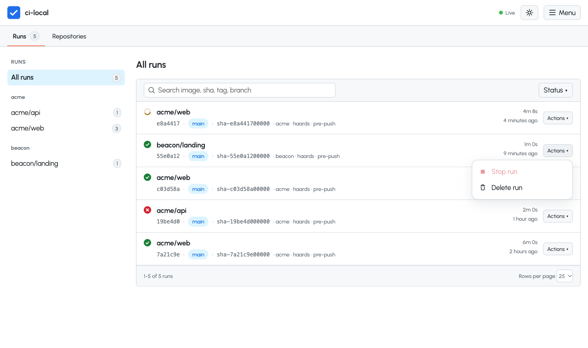
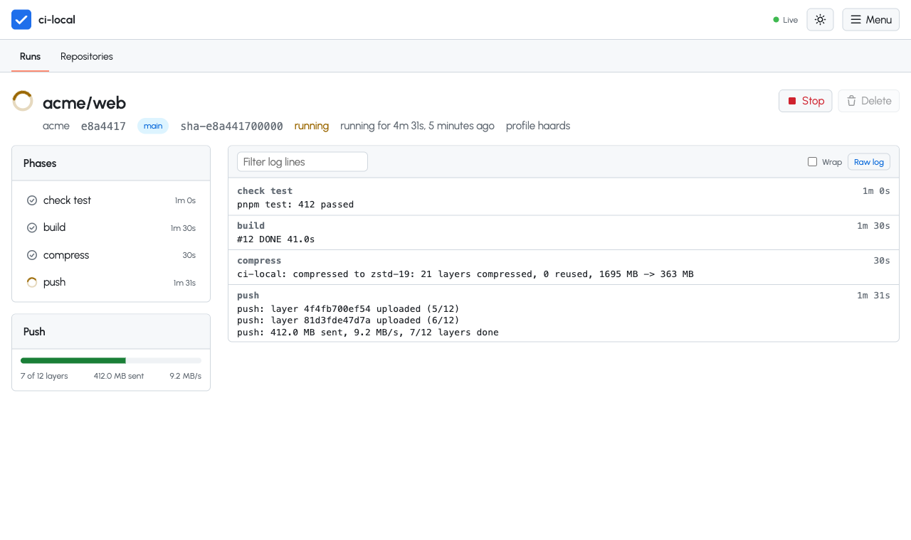
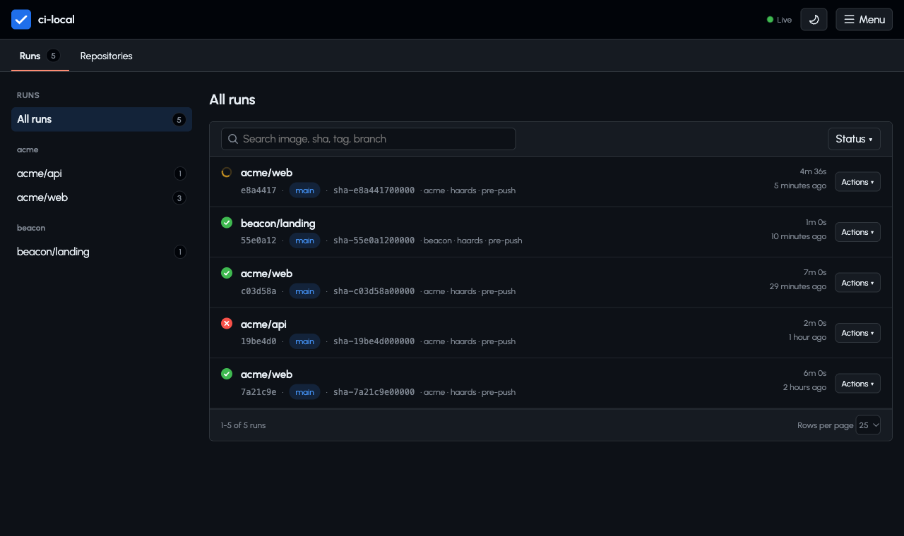

# ci-local

ci-local builds your container images on your own machine when you `git push` and publishes them to your registry before git sends the commits. Your server only has to pull the finished image.

## One push, step by step

On a push to a branch listed in the repository's config, this happens:

1. Anything already in your `pre-push` hook runs first.
2. ci-local runs the checks you configured, such as your test suite.
3. It builds the commit you are pushing and publishes the image as `sha-<content hash>`.
4. A push to the first listed branch will also move the `:prod` tag to that image.
5. git sends the commits to the remote.

A failed check, build or upload will stop the push. If the registry already has an image for the same content, ci-local skips the build.

## Web view

`ci-local ui` starts a local web view of your runs in the background. You can search and filter the list, read each run's phases and log, follow an upload, and stop or delete one run or many.

`ci-local ui` starts a local web view of every run in the background: filters, an Actions menu per run, bulk select, light and dark themes.



A run page shows the phases (checks, build, compress, push) with their log, and while an image uploads, the layers done, bytes sent and rate. Stop and Delete are on the page.





## Developer docs

### Install

You need:

- [Bun](https://bun.sh)
- Node.js 18 or newer, for the `ci-local` launcher that starts Bun
- `docker` (OrbStack or Docker Desktop)
- [crane](https://github.com/google/go-containerregistry/tree/main/cmd/crane) (`brew install crane`)
- a container registry your server can pull from
- ssh access to your server, if you reach the registry over ssh
- the `zstd` command (`brew install zstd`), only for `compression: zstd`

Git hooks call `ci-local` from your `PATH`. Install it globally from npm:

```sh
bun install -g ci-local
# or run it once without installing
npx ci-local doctor
# or run it once to see which tools are missing
bunx ci-local doctor
```

The npm release is 0.1.0, tagged `v0.1.0`. It ignores the config keys for these additions on the unreleased `main` branch:

- checks limited to named images
- `build_during_checks`
- several images at once (`concurrency`, `--jobs`)
- the machine-wide queues, `weight` and `ci-local queue`
- a longer timeout and retries for `bun test` inside checks

To run unreleased `main`, clone the repository and link the dependency-free launcher.

```sh
git clone https://github.com/danolez1/ci-local.git
cd ci-local
# any directory on your PATH works
ln -s "$PWD/bin/ci-local.mjs" ~/.local/bin/ci-local
```

### Machine profiles

A profile says where images are published. Put profiles in `~/.config/ci-local/config.yaml`, or `$CI_LOCAL_CONFIG_DIR/config.yaml`:

```yaml
default_profile: vps
profiles:
  vps:
    transport: ssh                  # ssh | https | direct
    ssh_host: my-vps                # alias from ~/.ssh/config, or user@host
    registry: 127.0.0.1:5000        # for ssh, the address as seen from the server
    pull_registry: 127.0.0.1:5000   # address in the deploy image printed after a push
  hub:
    transport: https
    registry: registry.example.com  # run docker login for it once
```

| Transport | How it reaches the registry |
|---|---|
| `ssh` | Port-forwards to a registry on the server's loopback. It needs no registry credentials and avoids a CDN's request-size cap. |
| `https` | Connects to the registry with your docker credentials. |
| `direct` | Behaves like `https`, for a registry you reach as it is. |

| transport | how it reaches the registry |
|---|---|
| `ssh` | Port-forward to a registry that only listens on the server's loopback. No credentials, and no request-size cap from a CDN in front (Cloudflare documents a 100 MB request-body limit on Free and Pro, which breaks large image layers). A failed upload is attempted three times in total, reopening the tunnel if ssh exited, and layers already uploaded are skipped. |
| `https` | Straight to the registry with the credentials in `~/.docker/config.json`. |
| `direct` | Same as `https` for a registry you reach as is. Set `insecure: true` for plain http. |

A profile also accepts `platform`, `insecure: true` (plain http) and `proxy`.

- A repository can define its own `profiles:` in `ci-local.yaml`. These win over global ones with the same name.
- The profile comes from `--profile`, then `CI_LOCAL_PROFILE`, then `profile:` in the repository, then `default_profile`.
- An upload has three attempts in total. Layers already in the registry are skipped. An exited ssh tunnel will be reopened.

#### Proxies

Commands started by ci-local run without `HTTP_PROXY`, `HTTPS_PROXY`, `ALL_PROXY` and `NO_PROXY`. Set `proxy: inherit` on a profile to keep them.

`ci-local doctor` shows the Docker daemon's own proxy setting, which is outside ci-local's control. A `proxyconnect` build error will end with the fix.

Every command ci-local runs has `HTTP_PROXY`, `HTTPS_PROXY`, `ALL_PROXY` and `NO_PROXY` removed from its environment, so a stale proxy in your shell never reaches docker or crane. Set `proxy: inherit` on a profile to keep them. The Docker daemon's own proxy is out of ci-local's reach (on OrbStack it follows `network_proxy`); `ci-local doctor` shows it, and a build that fails with `proxyconnect` ends with the fix.

### Repository setup

```sh
ci-local init --image acme/web          # writes ci-local.yaml
# alternative: also set up a gitignored file for public build values
ci-local init --image acme/web --build-env build.env
ci-local install-hook                   # adds the pre-push step
ci-local doctor                         # checks tools, config and the hook
```

#### ci-local.yaml reference

```yaml
version: 1
profile: vps                      # optional
branches: [main, release/*]       # pushes to these build and publish
concurrency: 3                    # unreleased, images of one push at once, 1 to 8
public_prefixes: [NEXT_PUBLIC_]   # optional, replaces the default prefixes
                                  # optional, keys allowed in build_env
public_jwt_keys: [NEXT_PUBLIC_SUPABASE_ANON_KEY]  # optional, keys that may hold a public JWT
                                  # optional, keys whose public value may be a JWT (anon and publishable keys); every other JWT is refused
images:
  - name: web
    image: acme/web               # repository path in the registry
    dockerfile: Dockerfile
    context: .
    platform: linux/amd64         # default; match the server
    # default; match the server's architecture
    # target: production          # a Dockerfile stage; default is the last one
    build_env: build.env          # committed file your Dockerfile reads
    # committed, public values only
    # build_env_local: local.env  # a gitignored file used the same way
    # instead of build_env, to keep the file gitignored (never the same file in both)
    build_args_file: args.env     # committed KEY=VALUE lines passed as --build-arg
    tag_exclude: [docs, README.md]  # paths that cannot change the image
    tag_include: []               # when set, only these paths decide the tag
    # weight: 1                   # unreleased, docker CPUs the build needs, 1 to 64
    # build_during_checks: true   # unreleased
    # compression: zstd           # default is gzip
    # default gzip; zstd layers are roughly a third smaller
    # zstd_level: 19              # 1 to 22
    # 1 to 22, default 19
checks:                           # optional, run before the build
                                  # optional, run on this machine before anything is built
  - name: test
    run: pnpm test
    # a shell command run in the repository root
    # ttl_hours: 24               # how long a pass counts for the same tree
    # how long a pass counts for the same tree; default until the tree changes
    # images: [web]               # unreleased, guard these images alone
    # guard only these images (by name); default every image
```

- `dockerfile`, `context`, `tag_exclude` and `tag_include` at the top level are defaults for every image. A monorepo lists several entries under `images`.
- Paths must be relative and inside the repository.
- Build env files and the build args file must be regular files, with no symlinks.
- `ci-local config` prints the resolved result.

#### Build values and the secret guard

`build_env` and `build_args_file` are read from the commit. `build_env_local` is read from your working tree, copied into the build context at the same path and hashed into the tag. The run fails if that file is committed. Commit a `<file>.example` template beside it. `init --build-env` creates that template for you.

- Every key needs a public prefix. The defaults are `NEXT_PUBLIC_`, `VITE_`, `PUBLIC_`, `NUXT_PUBLIC_` and `EXPO_PUBLIC_`.
- Values matching common credential formats are refused, including Stripe, Flutterwave, GitHub, Slack and AWS keys, private key blocks, `sk-` keys and JWTs.
- This is a pattern match. A secret in another format will get through. Keep secrets out of these files.
- `public_jwt_keys` allows a JWT for the keys you name. The guard cannot tell an anon key from a service-role key. List only keys that are public by design.

`public_jwt_keys` is an opt-in per key. The guard cannot tell an anon key from a service-role key, so name only keys that are public by design and keep secret ones out of build env files.

`build_env_local` is for values you would rather not commit: the file is read from your working tree, checked like `build_env`, copied into the build context at the same path, and hashed into the tag so a changed value never reuses an old image. Use one of `build_env` or `build_env_local` per file. Commit a `<file>.example` template next to it; `init --build-env` creates it and adds the real file to `.gitignore`, and `doctor` warns when the template is missing. Paths (`dockerfile`, `context`, `build_env`, `build_env_local`, `build_args_file`) must be relative and stay inside the repo, and the env files must be regular files, not symlinks. Top-level `dockerfile`, `context`, `tag_exclude` and `tag_include` are defaults for every image, so a monorepo lists several entries under `images`. `ci-local config` prints the resolved result.

#### Checks

Checks run on your machine, in the repository root, in order, before the image is pushed. By default they finish before the build starts. They are code from your own repository, like a git hook.

- The last pass is remembered with its tree and command. It is recorded only when the checked-out commit is the one being built and tracked files have no edits.
- A check with `images` runs for each listed image with `CI_LOCAL_IMAGE` set to its name.
- A check without `images` guards every image. On a clean tree it runs once and the other images reuse the pass.
- `ci-local run --no-checks` skips checks for a manual run.

On unreleased `main`, every `bun test` started by a check runs with `--timeout 30000 --retry 3`, unless the command sets the flag itself. Change the values with `CI_LOCAL_TEST_TIMEOUT` (milliseconds) and `CI_LOCAL_TEST_RETRY` (`0` turns retries off).

Set `build_during_checks: true` on an image to build it while its checks run. The push waits for every check. The build is cancelled when a check fails. The build and the tests share your CPU.

`checks` are commands the repository wants green before an image exists, usually its tests. They run in the repository root on your machine (so they can reach a local test database), in order, before docker or the registry tunnel is opened (an image with `build_during_checks` may start its build beside them), and a failing one stops the run and with it the push. The last pass is remembered with the tree it ran on in ci-local's state folder, so pushing the same content again, or a second image from the same commit, skips it. The pass is only remembered when the checked-out commit is the one being built and tracked files have no edits; otherwise the check runs and says so in the log. From the hook, checks run for the branches listed in `branches`. `ci-local run --no-checks` skips them for a manual run. They are code from your own repository, like a git hook. A check with `images` runs only before those images, once for each, with `CI_LOCAL_IMAGE` set to the image name, so a script can limit itself to that image's own code; a check without it guards every image and, because a pass is remembered for the tree, runs once per push without that variable. A check with `images` keeps one stamp for each image.

Checks run with a `bun` in front of PATH that adds `--timeout 30000 --retry 3` to every `bun test` they start, directly or through a package script, unless the command already sets that flag. bun's default of 5 seconds per test fails slow tests whenever the machine is also building images, and neither `bunfig.toml` nor an environment variable can raise it. Set `CI_LOCAL_TEST_TIMEOUT` (milliseconds) or `CI_LOCAL_TEST_RETRY` (`0` turns the retry off) to change it. A test that fails all four attempts will still fail the check. `bun --bun run <script>` starts scripts with its own `bun` and bypasses this.

`build_during_checks: true` starts an image's build as soon as the hash and guard phases finish, so it runs while the checks do instead of after them. The push still waits for every check, a failing check cancels the build, and an image that is already in the registry is still skipped. No early build starts for a tag that ci-local has already published from this machine. Use it for an image whose checks and build use different resources (tests on this machine, docker for the build); the build and the checks share the CPU, so expect slower tests while it runs.

#### Queues

On unreleased `main`, all ci-local processes on a machine share four queues. Parallel pushes take turns in them. The run that started earliest goes first, then arrival order decides. Only the first in line may start.

| Queue | Limit |
|---|---|
| tag | One run per image and content tag. A second run will wait, and will skip the build when the tag is in the registry. |
| image | 3 images in flight, each from start to end. |
| checks | The checks of one image at a time. |
| build | The Docker daemon's CPUs, shared out by each image's `weight`. |

- Builds that share a few CPUs can finish far later than the same builds one after another. On one machine the median build took 43 seconds alone and 505 seconds beside others. Give a heavy build a `weight` equal to the CPU count.
- `concurrency` and `ci-local run --jobs N` cap the images of one push. The image queue allows 3 at once. A cap above 3 will have no effect.
- `ci-local queue` lists who holds and who waits. Claims left by a killed process are dropped.

At most 3 images are in flight on the machine at once, counting every push, and four queues shared by every ci-local process decide who gets the resources and in what order. A claim is served by the time its image's run began, then by arrival, and only the first in line may start: a build that needs the whole machine is never starved by lighter ones behind it, and an earlier push is not overtaken by a later one. Waiting costs nothing, and the run log says the place in line and who is ahead.

- `images`: the 3 slots an image holds from its start to its end. The rest wait in a `queue image` phase, in the order their pushes began.
- `tag-*`: one lock per image and content tag. Two pushes of the same content, such as a retry started while the first still runs, would build and upload the image twice; the second waits in a `queue tag` phase, then finds the tag in the registry and skips. A tag another run already published is not built ahead of its checks (`build_during_checks`), and the registry still decides whether it is there, so a pruned tag is built again.
- `checks`: one image's checks at a time. They share the repository's working tree, its test database and the folder a check script exports into, and they load every core, so the checks of different images and different pushes take turns. An image whose checks have all passed on this tree does not wait.
- `build`: the docker daemon's CPUs, read from `docker info`. An image's `weight` (default 1, up to 64, cut down to the CPU count) is how many of them its build needs to itself. Builds that share the daemon's few CPUs finish far later than the same builds one after another (on one machine the median was 43 seconds alone and 505 seconds with two or more running), so give a heavy build, such as a Next app, a weight equal to the CPU count and it runs alone, while light ones run side by side up to the CPU count. The wait is the `queue build` phase of the run.

`ci-local queue` lists who holds and who waits in each queue. A claim of a process that was killed is dropped, so nothing stays blocked. `concurrency: N` (top level, 1 to 8, default 3) and `ci-local run --jobs N` cap how many images of one push are in flight, which only matters below 3. Every image has its own child processes, so a failing check cancels only that image's build, and one still waiting in the build queue gives up its place. A check that names no image, such as a shared `root` check, runs once and the images that need it find it already passed; a check with `images` still runs once per image. Echoed output carries an `[image]` prefix while more than one runs. Compression and the push are not queued: they follow the build and are short next to it.

#### zstd layers

With `compression: zstd`, ci-local recompresses each layer with the `zstd` CLI before the push. On a 1.15 GB image, zstd cut the upload from 601.7 MB to 406.3 MB.

- Compressed layers are cached for 14 days and reused when a layer is unchanged.
- The server pulling the image needs Docker Engine 23 or newer.
- The image is pushed with an OCI manifest straight from the build export. `--keep-local` has no effect on it.

`compression: zstd` exports the image as an OCI layout instead of loading it into Docker, recompresses each layer with the `zstd` CLI (`brew install zstd`) and pushes that. In a real 1.15 GB Next.js image it cut the upload from 601.7 MB to 406.3 MB at level 19. Recompressed layers are cached by content under the state directory for 14 days, so only changed layers are compressed again, and the push skips layers the registry already has. The server that pulls the image needs Docker Engine 23 or newer (or containerd 1.5 or newer). The image is pushed with an OCI manifest, so a registry that refuses Docker v2 manifests accepts it. `--keep-local` has no effect because the image never enters the local daemon.

### The pre-push hook

```sh
ci-local install-hook                  # picks husky, core.hooksPath or .git/hooks
ci-local install-hook --kind husky     # .husky/pre-push
ci-local install-hook --kind githooks  # .githooks/pre-push, and points core.hooksPath there
ci-local install-hook --remove
```

- The installer appends one marked block at the end of the hook, below your own steps. Run it again to move the block back to the end.
- `doctor` fails when the block is not last, when the hook is not a shell script, or when a top-level `exit` comes before the block.
- Pushed refs are read from stdin. If an earlier step already read them into a `refs` variable, that value is replayed. With neither, ci-local builds the checked-out branch when it is listed.
- If `ci-local` is missing from `PATH`, the hook prints a warning and the push goes through with no checks or image from ci-local.
- `CI_LOCAL_SKIP_IMAGE=1 git push` skips ci-local once.

It appends one marked block at the very end of the hook, so the image build is the last gate before git pushes. The order of a push to a configured branch is: your own hook steps, then ci-local (the repository's checks, the build, publishing the image to the registry, moving `:prod` on a push to the first listed branch), and only after all of that git sends the commits to the remote. Publishing the image is not the git push; that always comes last. Nothing is added above your existing steps. Running the install again moves the block back to the last line if someone appended a step after it, and `doctor` fails when it is not last, when the hook is not a shell script, or when a top-level `exit` comes before the block.

The pushed refs reach ci-local from stdin. Husky hooks that already read stdin into a `refs` variable get that variable replayed; if neither is available it builds the checked-out branch when that branch is listed in `branches`. An existing `core.hooksPath` is left alone and the hook is written where it points.

If `ci-local` is not on PATH the hook prints a warning and lets the push through, so a machine without the tool is never blocked.

### Manual runs

```sh
ci-local run                                   # HEAD of this repository
ci-local run --image web --sha v1.2 --dry-run
ci-local run --retag                           # also move :prod to this build
ci-local run --no-push --platform linux/arm64  # build and load locally only
ci-local run --background                      # detach and print the run id
printf 'repo: ~/work/app\nsha: main\nimages: [web]\ndry_run: true\n' | ci-local run --stdin
```

The `--stdin` job is YAML or JSON with `repo`, `sha`, `images`, `profile`, `platform`, `push`, `retag`, `dry_run` and `keep_local`. Unknown keys and wrong types are rejected. `--stdin` cannot be combined with `--background`.

`:prod` moves only for a hook push to the first entry of `branches`, or with `--retag`. Other runs publish the `sha-` tag alone.

The stdin job is YAML or JSON with `repo` (a leading `~` works), `sha`, `images`, `profile`, `platform`, `push`, `retag`, `dry_run` and `keep_local`. Unknown keys and wrong types are rejected, so a typo cannot turn a dry run into a real push. The hook itself reads git's pre-push lines on stdin (`ci-local hook pre-push`).

`:prod` moves only for a hook run on the first entry of `branches`, or when you pass `--retag`. Other runs publish the immutable `sha-` tag and leave `:prod` alone. `--keep-local` keeps the loaded image.

### Runs and logs

```sh
ci-local status               # recent runs, --json for the records
ci-local logs -f              # follow the newest log
ci-local watch                # live terminal view
ci-local ui                   # web view in the background, http://127.0.0.1:7777
ci-local ui start --open      # the same, and open the browser
ci-local ui serve             # web view in this terminal
ci-local ui status            # or restart, logs
ci-local ui-stop              # same as ci-local ui stop
ci-local ui install           # start at login (macOS); ui uninstall removes it
```

Each run writes `run.json` and a log under `~/.local/state/ci-local/runs/`, or under `$CI_LOCAL_STATE_DIR`. A force-killed run will show as `interrupted`. Over the `ssh` transport, the upload also reports bytes sent and the current rate.

Each run writes a record (`run.json`) and a log under `~/.local/state/ci-local/runs/` (`$CI_LOCAL_STATE_DIR` moves it). The record has the image, sha, branch, tag, trigger (`hook` or `manual`), status, per-phase timings, the deploy image once it is published, and the pid of the process running it. A run whose process was force-killed will show as `interrupted`. The log marks each phase as a group, which the web view folds. While an image is pushing, the log gets a line for each finished layer and, on the ssh transport, a status line every 15 seconds (bytes sent, rate, layers done), and the record's `push` field holds the same numbers.

```sh
ci-local status                  # recent runs
ci-local logs -f                 # follow the newest log
ci-local watch                   # live terminal view
ci-local ui                      # start the web view in the background and return, http://127.0.0.1:7777
ci-local ui-stop                 # stop it (same as ci-local ui stop)
ci-local ui serve                # run the web view in this terminal instead (ctrl-c stops it)
ci-local ui start --open         # same as ci-local ui, and open the browser
ci-local ui status               # or ci-local ui stop, restart, logs
ci-local ui install              # start it at login (macOS LaunchAgent); ui uninstall removes it
ci-local run --background        # build detached from the terminal; prints the run id to follow
```

Running `ci-local ui` while one is already up prints its address and changes nothing. If the login service is installed, `ui-stop` stops the server but the service starts it again; remove it with `ci-local ui uninstall`.

#### Web view details

- The run list can be filtered by status and repository and searched. A repositories page shows the success rate and median build time.
- There are light, dark and system themes. Press `?` for the keyboard shortcuts.
- Stop signals the ci-local process behind a run. A push waiting on that run will fail. Delete removes a finished run's record and log.
- `POST /api/runs/bulk` takes `{"action": "stop" | "delete", "ids": [...]}` with at most 200 ids.
- The server listens on loopback only. Stop and delete requests need the header `x-ci-local: 1`. A browser request must come from the page's own origin.
- `--port` picks another port.
- If the login service is installed, it starts the server again after `ui-stop`.

To stop or delete many runs at once, tick the checkboxes in the web view's list. The header box selects the page and shift-click selects a range. The bar that appears shows how many selected runs Stop (the running ones) and Delete (the finished ones) will touch, and each asks once before acting. The selection clears when you change page or filter.

The bar calls `POST /api/runs/bulk` with `{"action": "stop" | "delete", "ids": [...]}`, at most 200 ids. It applies the same checks as the single-run routes and answers with a result per id.

The web view has paged, filterable run lists (status, repository, search), a run page with phases and a filterable log, a repositories page with success rate and median build time, light, dark and system themes, and keyboard shortcuts (`?` lists them). While an image is pushing, the run page shows layers done, bytes sent and the current rate (bytes are counted on the ssh transport only; other transports show layers). Each run has Stop and Delete: the run page shows both buttons, and the list has an Actions menu on every row. Stop signals the ci-local process running it (after checking that the process really is ci-local), which cancels its docker build, upload and ssh tunnel and marks the run failed, and a push waiting on it fails. Delete removes a finished run's record and log. Changes only work from the page's own origin and carry a marker header, so another site open in your browser cannot trigger them, and the server binds to loopback because logs can name internal hosts. The page uses the Urbanist font (SIL Open Font License, copy in `src/ui/fonts/OFL.txt`), served by the tool itself so it works offline, and logs use a terminal monospace stack; the CSS variables `--log-size` and `--log-leading` in the page's `:root` set their size and spacing. `--port` picks another port; the background copy remembers its port in `ui.json` in the state directory.

### Tags and build contents

- The build context is the output of `git archive`: committed files, plus `build_env_local` when you set it.
- The tag is `sha-` plus a hash of the committed files that can change the image: everything minus `tag_exclude`, narrowed to `tag_include` when set.
- The hash also covers the platform, Dockerfile path, context, target and the content of `build_env_local`.
- The platform comes from `--platform`, the image, the profile, then `linux/amd64`.

- The image is built from `git archive <sha>`, the files a clone would see. Untracked and ignored files reach it only through `build_env_local`, so a build that depends on any other local-only file will fail on your machine first.
- The tag is `sha-` plus a hash of the committed files that can change the image (everything minus `tag_exclude`, or only `tag_include`), the platform, the Dockerfile path and the `target`. A commit that changes nothing relevant finds its tag already in the registry and skips the build.
- `build_env`, `build_env_local` and `build_args_file` may only hold public values. Every key needs a public prefix (`NEXT_PUBLIC_`, `VITE_`, `PUBLIC_`, `NUXT_PUBLIC_`, `EXPO_PUBLIC_` by default), and values matching common credential formats (Stripe, GitHub, Slack and AWS keys, private key blocks, JWTs, `sk-` keys) are refused. That is a pattern check, not proof a value is safe. Secrets stay in the deploy platform's environment.

### zot registry settings

The notes below apply to version 2.1.21 of zot, an OCI registry.

- The default limit in zot is 60 seconds for reading a request, body included, and 60 seconds for writing the response. For large layers, set `http.readTimeout` and `http.writeTimeout` higher, for example `30m`.
- The response to a Docker v2 manifest is 415 (`MANIFEST_INVALID`) unless `http.compat` lists `docker2s2`. Images pushed with `compression: zstd` use OCI manifests and need no such setting.

Large images expose limits that a small test never hits.

- **Per-request time limits.** zot v2.1.21 answers a layer upload that lasts over 60 seconds with a 500 `i/o timeout`, even while bytes are flowing, and crane reports it as `EOF` or `use of closed network connection`. Set `http.readTimeout` and `http.writeTimeout` (for example `30m`) in zot's `config.json`. A registry behind a CDN has its own request-body cap, which is why the `ssh` transport goes to the registry directly.
- **Config changes need a restart.** A redeploy from git updated the bind-mounted `config.json` on the server without restarting the zot container, so the old settings stayed live. Restart the container after changing the file and check its start time.
- **Docker v2 manifests.** crane pushes a `docker save` tarball with a Docker v2 manifest. zot v2.1.21 refuses it with 415 (crane shows `MANIFEST_INVALID`) unless `http.compat` lists `docker2s2`. Images with `compression: zstd` are pushed with an OCI manifest and do not need that setting.
- **Slow links.** A first push of a large image takes as long as the upload, so watch it in the web view. Later pushes only send the layers that changed, so keep rarely changing layers (dependencies, base packages) before frequently changing ones in the Dockerfile and avoid `chown -R` or `chmod -R` on a copied tree, which stores every file a second time.

### Deploying

Each push prints the deploy image. With the `ssh` example above, the server pulls `127.0.0.1:5000/<image>:prod` or the exact `:sha-...` tag from its own registry.

The server pulls from its own loopback registry: `127.0.0.1:5000/<image>:prod`, or the exact `:sha-...` each run prints. In Dokploy, an Application uses the Docker provider with that image, and a Compose project uses `image:` instead of `build:`. A mutable `:prod` is only re-pulled when the redeploy forces a pull; the immutable tag always is. Runtime environment variables stay in the platform.

### Developing ci-local

```sh
bun install
bun run test
bun run typecheck
bun test            # unit and end-to-end tests, no docker or network needed
```

The tests stand in for `docker` and `crane` with stub scripts. Tests that need `zstd` are skipped when it is missing.

| Path | Contents |
|---|---|
| `bin/ci-local.mjs` | launcher |
| `src/cli.ts` | commands |
| `src/engine.ts`, `src/queue.ts`, `src/checks.ts` | one image run, the queues, the checks |
| `src/registry.ts`, `src/recompress.ts` | push and tunnel, zstd |
| `src/ui/` | web view server and page |
| `examples/` | sample config files |
| `test/` | tests |

## License

[MIT](LICENSE). The web view ships the Urbanist font under the SIL Open Font License ([copy](src/ui/fonts/OFL.txt)).
